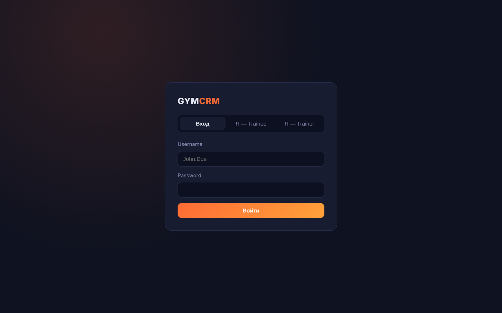
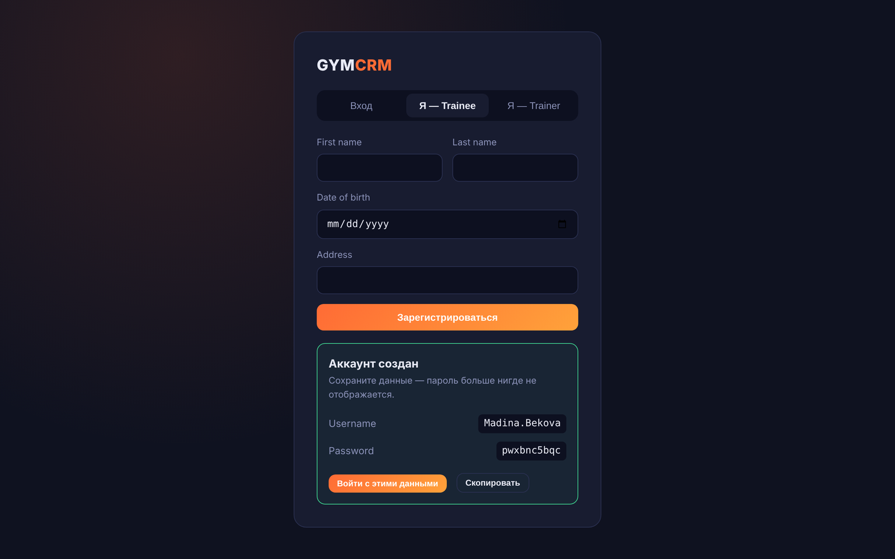
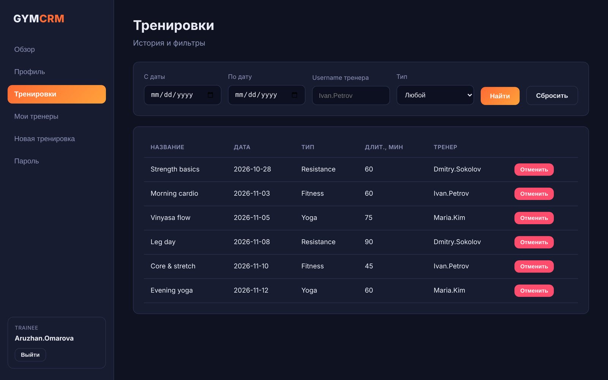
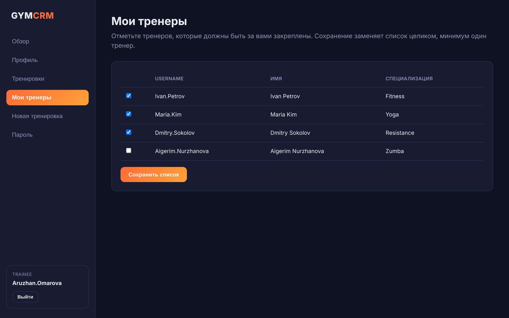
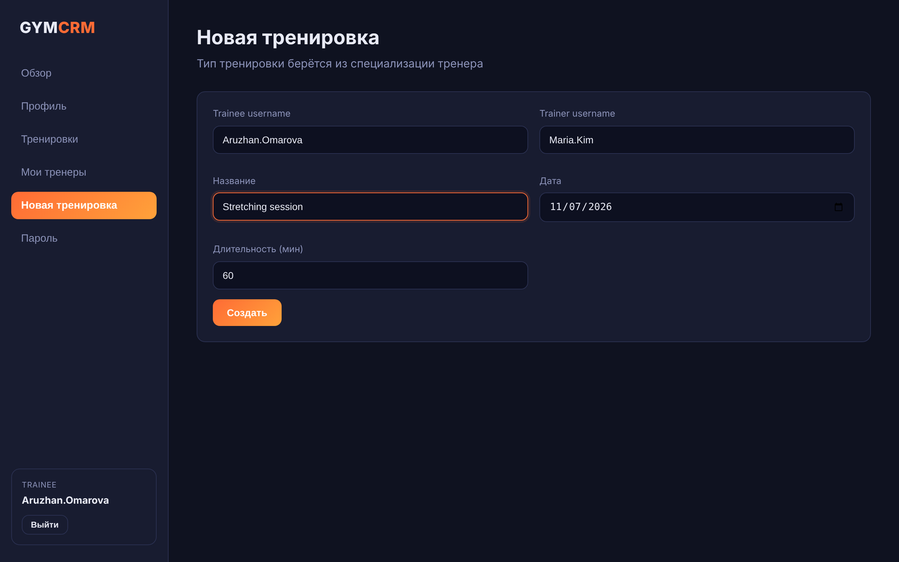
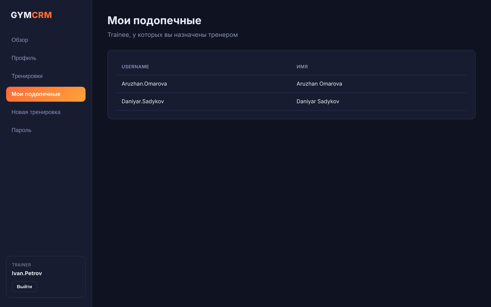
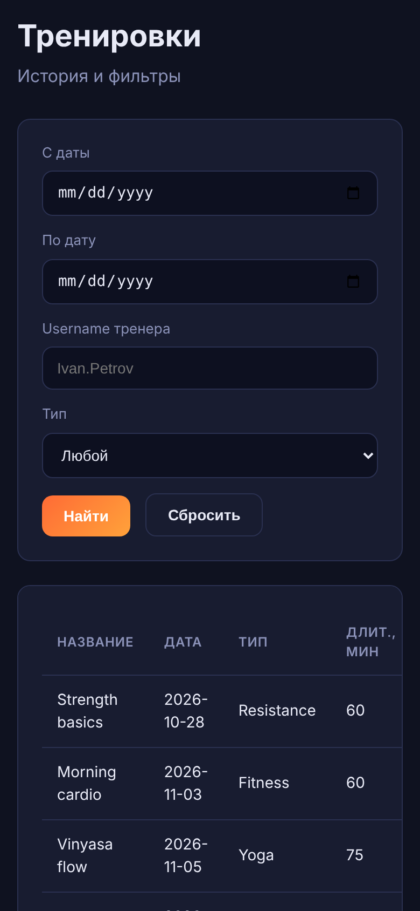
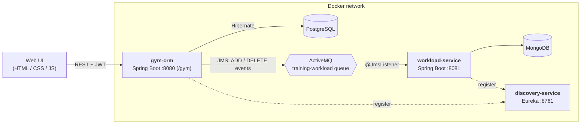

# Gym CRM

A microservice-based CRM for gyms: manage **trainees**, **trainers** and **training sessions**, authenticate with **JWT**, and track every trainer's **monthly workload** asynchronously through a message broker. Ships with a ready-to-use web UI.


---

## Table of contents

- [About](#about)
- [Screenshots](#screenshots)
- [Features](#features)
- [Architecture](#architecture)
- [Tech stack](#tech-stack)
- [Key engineering features](#key-engineering-features)
- [Getting started](#getting-started)
- [Using the application](#using-the-application)
- [REST API](#rest-api)
- [Configuration](#configuration)
- [Monitoring](#monitoring)
- [Testing](#testing)
- [Project structure](#project-structure)
- [Author](#author)

---

## About

Gym CRM is a learning project that grew into a small but complete system. It covers the full life cycle of a gym's day-to-day data:

- people register as **trainees** or **trainers** and receive generated credentials;
- trainees pick the trainers they work with and schedule **trainings**;
- every created or cancelled training is published as an event to **ActiveMQ**;
- a separate **workload-service** consumes those events and keeps each trainer's hours per year and month in **MongoDB**;
- all services register in a **Eureka** discovery server and run in **Docker** containers.

The backend also serves a lightweight single-page UI (plain HTML, CSS and JavaScript — no build step), so the whole system can be explored from a browser at `http://localhost:8080/gym/`.

> The web UI is in Russian; the API, code and documentation are in English.

## Screenshots

<p align="center">
  
  
</p>
<p align="center"><em>Sign in, or register as a trainee / trainer — the generated username and password are shown once.</em></p>

<p align="center">
  
</p>
<p align="center"><em>Trainee's trainings: filter by period, trainer and training type; cancel a training.</em></p>

<p align="center">
  
  
</p>
<p align="center"><em>Manage your trainers · schedule a new training.</em></p>

<p align="center">
  
  
</p>
<p align="center"><em>Role-aware UI (trainer's view) · responsive mobile layout.</em></p>

## Features

**Accounts & security**
- Registration for trainees and trainers with an automatically generated username (`First.Last`, with a numeric suffix for duplicates) and a random password
- Stateless **JWT** authentication, logout with token revocation, password change
- Brute-force protection: 3 failed logins block the account for 5 minutes
- Activate / deactivate accounts

**Trainees**
- View and update the profile (date of birth, address, status), delete the profile together with its trainings
- Browse active trainers that are not yet assigned and **replace the list of own trainers**
- List trainings filtered by period, trainer and training type

**Trainers**
- View and update the profile (the specialization is read-only)
- See assigned trainees; list trainings filtered by period and trainee

**Trainings**
- Create a training (the training type comes from the trainer's specialization) and cancel it
- Reference list of training types: *Fitness, Yoga, Zumba, Stretching, Resistance*

**Workload service**
- Consumes `ADD` / `DELETE` training events from the queue
- Stores per-trainer workload aggregated by **year → month** in MongoDB
- Exposes the summary through a secured REST API

**Web UI**
- Login / registration, profile, trainings with filters, trainer management, new training, password change
- Menu and forms adapt to the role (trainee or trainer); responsive layout

## Architecture



| Service | Port | Responsibility |
|---|---|---|
| `gym-crm` (root module) | `8080`, context path `/gym` | Main REST API, JWT security, PostgreSQL persistence, event publishing, serves the web UI |
| `workload-service` | `8081` | Consumes training events, stores trainer workload in MongoDB, exposes it via REST |
| `discovery-service` | `8761` | Eureka service registry |
| PostgreSQL | `5432` | Relational data: users, trainees, trainers, trainings, training types |
| MongoDB | `27017` | Trainer workload documents |
| ActiveMQ | `61616` (broker), `8161` (console) | Asynchronous messaging between `gym-crm` and `workload-service` |

## Tech stack

| Area | Technologies |
|---|---|
| Language / build | Java 21, Gradle (multi-module, wrapper included) |
| Framework | Spring Boot 3.3.5, Spring MVC, Spring Security, Spring AOP, Bean Validation |
| Persistence | Hibernate (`SessionFactory`, Criteria API), PostgreSQL, Spring Data MongoDB, MongoDB |
| Messaging | ActiveMQ (JMS) |
| Microservices | Spring Cloud 2023.0.6, Netflix Eureka (server and clients) |
| Security | JWT (jjwt 0.12.6), BCrypt, CORS |
| Observability | Spring Boot Actuator, Micrometer, Prometheus registry, Logback |
| Testing | JUnit 5, Mockito, H2, Cucumber (BDD), Testcontainers |
| Infrastructure | Docker (multi-stage builds) |
| Frontend | Vanilla HTML / CSS / JavaScript |

## Key engineering features

- **Event-driven integration.** Creating or cancelling a training publishes a JSON event to ActiveMQ; the workload service processes it independently, so the main API never waits for it.
- **Distributed tracing of a request.** A `X-Transaction-Id` header (generated when absent) is put into the logging MDC, returned to the client and **propagated through JMS** into `workload-service`, so one user action can be followed across both services' logs.
- **Layered design.** `controller → service → dao → entity`, with dedicated DTOs and mapper classes, transactional service layer and a custom DAO layer built on Hibernate's `SessionFactory` and the Criteria API.
- **Security.** Stateless JWT filter chain, BCrypt (strength 12), in-memory token blacklist for logout, brute-force lock-out, configurable CORS, and a global exception handler returning a uniform error payload with the transaction id.
- **Observability.** Custom health indicators (database latency with a `DEGRADED` state, training-type reference data), custom Micrometer metrics and a logging aspect that records every REST call with its request and response.
- **Environment profiles.** `local`, `dev`, `stg`, `prod` with different schema-management strategies and log levels.
- **Containerised.** Every service has a multi-stage `Dockerfile` (JDK to build, JRE to run; `gym-crm` and `workload-service` run as a non-root user).
- **Well tested.** Unit tests per layer, a Cucumber BDD suite, tag-based test selection and Testcontainers-based tests for the MongoDB module.

## Getting started

### Prerequisites

- [Docker](https://docs.docker.com/get-docker/) (Docker Desktop on Windows / macOS)
- *(optional, for running without containers or running tests)* JDK 21

### 1. Clone the repository

```bash
git clone https://github.com/Alibel56/gym-crm.git
cd gym-crm
```

### 2. Create a network and start the infrastructure

```bash
docker network create gym-net

docker run -d --name postgres --network gym-net -p 5432:5432 -e POSTGRES_PASSWORD=password postgres:16
docker run -d --name activemq --network gym-net -p 61616:61616 -p 8161:8161 apache/activemq-classic
docker run -d --name mongo    --network gym-net -p 27017:27017 mongo:7
```

Wait a few seconds for PostgreSQL to start, then create the schema used by the application:

```bash
docker exec postgres psql -U postgres -c "CREATE SCHEMA IF NOT EXISTS task1;"
```

### 3. Build the images

Run from the repository root:

```bash
docker build -t gym-discovery -f discovery-service/Dockerfile .
docker build -t gym-workload  -f workload-service/Dockerfile .
docker build -t gym-crm .
```

### 4. Start the services (in this order)

```bash
docker run -d --name discovery --network gym-net -p 8761:8761 gym-discovery

docker run -d --name workload --network gym-net -p 8081:8081 \
  -e EUREKA_URL=http://discovery:8761/eureka/ \
  -e ACTIVEMQ_URL=tcp://activemq:61616 \
  -e MONGODB_URI=mongodb://mongo:27017/workload_service \
  gym-workload

docker run -d --name gym-crm --network gym-net -p 8080:8080 \
  -e DB_URL="jdbc:postgresql://postgres:5432/postgres?currentSchema=task1" \
  -e EUREKA_URL=http://discovery:8761/eureka/ \
  -e ACTIVEMQ_URL=tcp://activemq:61616 \
  gym-crm
```

> **PowerShell:** replace the trailing `\` line continuations with a backtick (`` ` ``) or put each command on one line.

Follow the startup with `docker logs -f gym-crm` and wait for `Started GymCrmApplication`.

### 5. Open the application

| What | URL |
|---|---|
| **Web UI** | http://localhost:8080/gym/ |
| Health check | http://localhost:8080/gym/actuator/health |
| Eureka dashboard | http://localhost:8761 |
| ActiveMQ console (`admin` / `admin`) | http://localhost:8161 |

### Starting and stopping later

```bash
# start again (infrastructure first, then the services)
docker start postgres activemq mongo
docker start discovery
docker start workload gym-crm

# stop
docker stop gym-crm workload discovery mongo activemq postgres
```

> After changing the code, rebuild the image and recreate the container — `docker restart` keeps running the old jar:
> `docker rm -f gym-crm && docker build -t gym-crm . && docker run ...` (same command as in step 4).

### Running from source (without Docker for the apps)

Keep PostgreSQL, ActiveMQ and MongoDB running in Docker (ports above are published to `localhost`), create the `task1` schema, then start the services with the default `local` profile:

```bash
./gradlew :discovery-service:bootRun    # terminal 1
./gradlew :workload-service:bootRun     # terminal 2
./gradlew bootRun                       # terminal 3 (gym-crm)
```

On Windows use `gradlew.bat`.

## Using the application

1. Open http://localhost:8080/gym/ and choose **Я — Trainer** to register a trainer (pick a specialization), then **Я — Trainee** to register a trainee.
2. **Save the generated username and password** — the password is displayed only once. Use *Войти с этими данными* to sign in right away.
3. As a trainee, open **Мои тренеры**, tick the trainers you want and save.
4. Open **Новая тренировка**, choose a trainer, a date and a duration, and create the training.
5. Check **Тренировки** — filter by period, trainer or type, or cancel a training.
6. Every create / cancel is sent to `workload-service`; read the trainer's workload from its REST API (see below).

> Cancelling a training from the UI needs the training `id` in the trainings list response (`GetTraineeTrainingsListResponse` / `GetTrainerTrainingsListResponse`); the button is hidden when the API does not return it.

## REST API

All endpoints are prefixed with `/gym`. Everything except registration, login, the training-types list and the health endpoint requires `Authorization: Bearer <token>`.

**Authentication** — `/gym/api/auth`

| Method | Path | Description |
|---|---|---|
| `POST` | `/trainee/register` | Register a trainee, returns generated credentials |
| `POST` | `/trainer/register` | Register a trainer, returns generated credentials |
| `POST` | `/login` | Returns a JWT (`token`, `tokenType`, `expiresInSeconds`) |
| `PUT` | `/password` | Change password |
| `POST` | `/logout` | Revoke the current token |

**Trainees** — `/gym/api/trainees`

| Method | Path | Description |
|---|---|---|
| `GET` | `/{userName}` | Get profile |
| `PUT` | `/` | Update profile |
| `DELETE` | `/{userName}` | Delete profile with its trainings |
| `PATCH` | `/status` | Activate / deactivate |
| `GET` | `/{userName}/unassigned-trainers` | Active trainers not assigned to the trainee |
| `PUT` | `/trainers` | Replace the trainee's trainers list |
| `GET` | `/{userName}/trainings` | Trainings, filters: `periodFrom`, `periodTo`, `trainerName`, `trainingType` |

**Trainers** — `/gym/api/trainers`

| Method | Path | Description |
|---|---|---|
| `GET` | `/{userName}` | Get profile |
| `PUT` | `/` | Update profile |
| `PATCH` | `/status` | Activate / deactivate |
| `GET` | `/{userName}/trainings` | Trainings, filters: `periodFrom`, `periodTo`, `traineeName` |

**Trainings & reference data**

| Method | Path | Description |
|---|---|---|
| `POST` | `/gym/api/trainings` | Create a training |
| `DELETE` | `/gym/api/trainings/{id}` | Cancel a training (notifies the workload service) |
| `GET` | `/gym/api/training-types` | List training types |

**Workload service** — `http://localhost:8081` (same JWT, no context path)

| Method | Path | Description |
|---|---|---|
| `POST` | `/api/v1/workloads` | Apply a workload update |
| `GET` | `/api/v1/workloads/{username}` | Trainer's workload by year and month |
| `GET` | `/api/v1/workloads/{username}/monthly?year=&month=` | Workload for a single month |

A ready-to-import **Postman collection** is included: [`src/main/resources/gym-api.postman_collection.json`](src/main/resources/gym-api.postman_collection.json) (set `baseUrl` to `http://localhost:8080/gym`).

Quick example:

```bash
# register a trainee
curl -X POST http://localhost:8080/gym/api/auth/trainee/register \
  -H "Content-Type: application/json" \
  -d '{"firstName":"Aruzhan","lastName":"Omarova"}'

# log in and use the token
curl -X POST http://localhost:8080/gym/api/auth/login \
  -H "Content-Type: application/json" \
  -d '{"userName":"Aruzhan.Omarova","password":"<generated-password>"}'

curl http://localhost:8080/gym/api/trainees/Aruzhan.Omarova \
  -H "Authorization: Bearer <token>"
```

## Configuration

Settings are read from `application.yml` and can be overridden with environment variables.

| Variable | Default | Used by | Description |
|---|---|---|---|
| `SPRING_PROFILES_ACTIVE` | `local` | all | Active profile: `local`, `dev`, `stg`, `prod` |
| `SERVER_PORT` | `8080` / `8081` | crm / workload | HTTP port |
| `DB_URL` | `jdbc:postgresql://localhost:5432/postgres?currentSchema=task1` | gym-crm | PostgreSQL JDBC URL (no default in `prod`) |
| `DB_USERNAME` | `postgres` | gym-crm | Database user (no default in `prod`) |
| `DB_PASSWORD` | `password` in `local` | gym-crm | Database password (**required** in `dev`, `stg` and `prod`) |
| `MONGODB_URI` | `mongodb://localhost:27017/workload_service` | workload | MongoDB connection string |
| `ACTIVEMQ_URL` | `tcp://localhost:61616` | both | Broker URL |
| `ACTIVEMQ_USER` / `ACTIVEMQ_PASSWORD` | `admin` / `admin` | both | Broker credentials |
| `JMS_TRAINING_WORKLOAD_QUEUE` | `training-workload` | both | Queue name (must match on both sides) |
| `EUREKA_URL` | `http://localhost:8761/eureka/` | crm / workload | Eureka server URL |
| `JWT_SECRET` | *development key* | both | Base64 HMAC secret — **must be identical in both services and changed in production** |
| `JWT_EXPIRATION_SECONDS` | `3600` | gym-crm | Token lifetime |
| `CORS_ALLOWED_ORIGINS` | `http://localhost:3000,http://localhost:4200` | gym-crm | Allowed origins when the UI is hosted separately |

**Profiles**

| Profile | Schema management (`hbm2ddl`) | Notes |
|---|---|---|
| `local` | `create-drop` | Default; tables are recreated on every start, SQL logging on |
| `dev` | `update` | SQL logging on; `DB_PASSWORD` must be provided |
| `stg` | `validate` | `DB_PASSWORD` must be provided |
| `prod` | `validate` | `DB_URL`, `DB_USERNAME` and `DB_PASSWORD` must all be provided; quieter log levels |

## Monitoring

Actuator is available under `/gym/actuator`. `health` and `info` are public; `metrics` and `prometheus` require a JWT.

- **Health:** `/gym/actuator/health` — includes database latency (`UP` / `DEGRADED` / `DOWN`) and the training-type reference-data check, plus liveness / readiness probes.
- **Prometheus:** `/gym/actuator/prometheus` with custom metrics:
    - `gym_active_trainees` — gauge of active trainees
    - `gym_registrations_total` — registrations, tagged by `role`
    - `gym_authentication_attempts_total` — successful / failed logins
    - `gym_training_creation_seconds` — training creation timer
- **Logs:** each line carries the transaction id; every REST call is logged with its request and response.

## Testing

```bash
./gradlew test       # gym-crm: unit tests + Cucumber BDD scenarios (in-memory H2)
./gradlew allTests   # all modules (workload-service tests use Testcontainers and need Docker)
```

Run a subset by tag (`positive`, `negative`, `edge`, `exception`):

```bash
./gradlew test -DincludeTags=positive
./gradlew test -DincludeTags=negative,exception
```

## Project structure

```
gym-crm/
├── src/main/java/com/practice/
│   ├── controller/      REST controllers (auth, trainee, trainer, training, training types)
│   ├── service/         business logic and transactions
│   ├── dao/             repositories on top of Hibernate SessionFactory / Criteria API
│   ├── entity/          JPA entities (User, Trainee, Trainer, Training, TrainingType)
│   ├── dto/             request / response records
│   ├── mapper/          entity ⇄ DTO mappers
│   ├── security/        JWT filter and service, brute-force protection, token blacklist
│   ├── messaging/       JMS publisher and event model
│   ├── metrics/ health/ custom Micrometer metrics and health indicators
│   ├── logging/         transaction-id filter, REST logging aspect
│   ├── exception/       global exception handler and error payload
│   └── config/          security, Hibernate, web, filters, reference-data initializer
├── src/main/resources/
│   ├── static/          web UI (index.html, style.css, app.js)
│   ├── application*.yml configuration profiles
│   └── gym-api.postman_collection.json
├── src/test/            unit tests, Cucumber features
├── workload-service/    MongoDB workload microservice (JMS listener + REST)
├── discovery-service/   Eureka server
├── docs/screenshots/    images used in this README
└── Dockerfile           image of the main service
```

## Author

**Alibek Aglanov** — [@Alibel56](https://github.com/Alibel56)

Built as a learning project while studying Java and Spring during the EPAM Lab program.